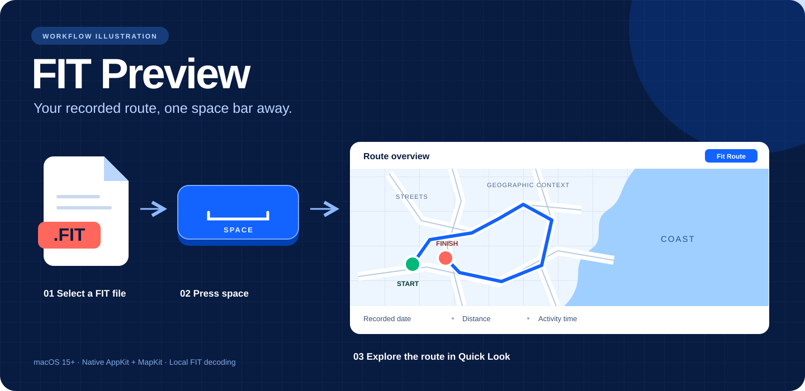
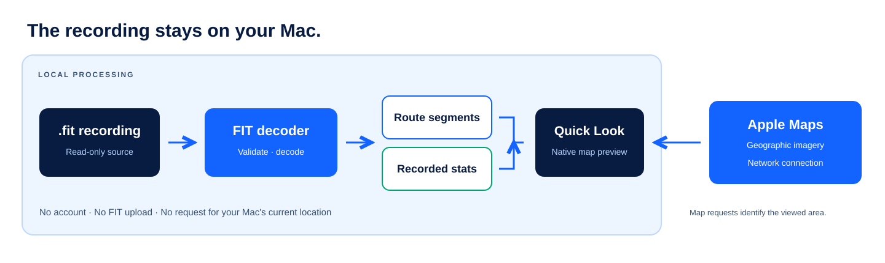
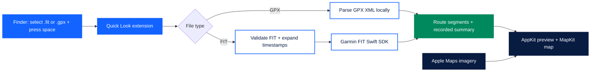

# FIT Preview

**Select a FIT or GPX file in Finder. Press the space bar. Explore the route on a geographic map.**



<p align="center">
  
  
  
  
</p>

FIT Preview is a native macOS app with an embedded Quick Look extension for FIT activity and course files and GPX tracks and routes. It reads the recording on your Mac and draws its route over a labeled Apple Maps basemap.

The illustrations explain the workflow and data flow. They are diagrams; visual acceptance of the installed Quick Look interface is still pending. See the [verification record](docs/VERIFICATION.md).

## What appears in the preview

| Feature | Behavior |
| --- | --- |
| **Geographic route overview** | Frames the complete recorded route with margin, including routes crossing the international date line. |
| **Interactive map** | Pan, zoom, and use **Fit Route** to return to the overview. |
| **Start and finish** | Markers identify the first and last valid GPS positions. |
| **Recorded summary** | Shows available date, distance, and time. GPX distance is approximate and GPX duration is labeled Elapsed. |
| **GPS gaps and pauses** | Missing positions, FIT timer stops and session boundaries, and GPX track segments remain separate. |
| **Files without GPS** | Displays an explanation and any available summary, including indoor activities and settings files. |
| **Invalid files** | Displays a readable error for unreadable, malformed, or oversized recordings. |

## Get started

**This repository currently provides source and a locally signed development build. A downloadable, Developer ID-signed and notarized release has not been published.**

### Build requirements

- macOS 15 or later.
- Xcode with Swift 6 package support; development was verified with Xcode 27 on macOS 27.0.1.
- Network access for the initial Swift Package Manager dependency download and Apple Maps imagery.

```sh
git clone https://github.com/bleeckerj/nfl-fit-file-preview.git
cd nfl-fit-file-preview
bash scripts/build.sh
bash scripts/install.sh
```

You can also open [FITPreview.xcodeproj](FITPreview.xcodeproj) in Xcode and build the **FITPreview** scheme. Garmin's FIT SDK version and the resolved dependencies are pinned in the project and package lockfile.

### Preview a recording

1. Keep **FIT Preview.app** in `~/Applications`; it contains the extension Finder uses.
2. Select a `.fit`, `.FIT`, `.gpx`, or `.GPX` file in Finder.
3. Press **space** to open Quick Look.
4. Explore the map, then press **space** again to close the preview.

If Finder shows a generic file icon, enable **FIT Route Preview** in **System Settings → General → Login Items & Extensions → Quick Look**, then close and reopen the preview.

### Install a rebuilt version

```sh
bash scripts/build.sh
bash scripts/install.sh --update
```

The installer stages and verifies the new app, saves the previous FIT Preview build under `.build/PreviousInstalls`, and registers the updated extension.

## Data and privacy



- **Local file decoding.** The source recording is opened read-only and is not uploaded.
- **Network basemap.** MapKit requests imagery from Apple. Map-service requests can identify the geographic area being viewed.
- **No account or backend.** The preview requires no login, API key, or permission to access the Mac's current location.
- **Bounded file size.** Source recordings over 100 MB are rejected.

Activity time uses complete FIT session timer totals. When those are unavailable, complete session elapsed totals are labeled **Elapsed**. Large gaps between record timestamps are never interpreted as activity time. Missing summary fields remain absent; course files without sessions can use their recorded distance field.

GPX 1.0 and 1.1 tracks and routes use the same map. When a file contains both, valid track points take precedence over the planned route. Each track segment and route remains separate; invalid coordinates split the line. Standalone waypoints are not connected into a route, so waypoint-only files show the no-route explanation.

GPX distance is estimated from adjacent coordinates within each segment and labeled **Approx.** It excludes elevation and the gaps between segments. **Elapsed** sums timestamp differences within segments only when all displayed points have valid, nondecreasing timestamps. Missing or reversed times leave duration absent. The date uses the first available displayed point timestamp, falling back to GPX metadata time. XML external resources are never fetched and custom internal entity declarations are rejected. The [GPX schema](https://www.topografix.com/GPX/1/1/) documents the source format.

## How it works



| Module | Responsibility |
| --- | --- |
| [`Sources/Core`](Sources/Core) | FIT and GPX decoding, file-type routing, FIT timestamp expansion, summary model, route segments, and geographic bounds. |
| [`Sources/Preview`](Sources/Preview) | AppKit layout, stats formatting, MapKit route geometry, and map rendering. |
| [`Sources/Extension`](Sources/Extension) | Asynchronous Quick Look requests, cancellation, and stale-preview protection. |
| [`Sources/App`](Sources/App) | Host app and setup guidance. |

Garmin's official FIT Swift SDK is pinned to **21.217.0**. That version rejects compressed timestamp headers, so a focused preprocessing module checks the file envelope, CRCs, and record boundaries, then expands compressed timestamps in memory. The implementation follows Garmin's FIT protocol specification. Review of OMATA Utility App's parser informed the timestamp and session handling.

The imported file types are `com.garmin.fit` and `com.topografix.gpx`. Files associated with another application's unrelated identifier may require a matching supported-type declaration.

## Tests and verification

```sh
# Run the automated suite.
bash scripts/test.sh

# Include a real recording in local integration verification.
bash scripts/test.sh /path/to/recording.fit
```

The second command copies the recording to the ignored `.build/Verification` folder. Activity recordings and build artifacts are excluded from Git.

**Latest verification, October 25, 2026: 38 tests passed, including 15 GPX tests.** GPX coverage includes tracks and routes, namespaces, segment boundaries, estimated distance, elapsed time, external entity isolation, invalid XML, file dispatch, cancellation, size limits, and 25,000 points.

**Original FIT verification: 23 tests passed.** Coverage includes binary decoding, compressed timestamp rollover, big-endian records, developer payload preservation, CRC failures, malformed definitions, missing GPS, valid zero coordinates, multiple sessions, pause gaps, cancellation, date-line geometry, and a 25,000-point recording. A real OMATA recording with **6,491 GPS points** decoded in approximately **one second** on the development Mac.

The original app build, strict signature checks, FIT type resolution, extension registration, and extension process launch were verified. Visible map imagery, framing, markers, pan/zoom, resizing, file switching, and offline presentation remain on the [visual acceptance checklist](docs/VERIFICATION.md#remaining-visual-acceptance).

For registration diagnostics:

```sh
pluginkit -m -v -i com.nearfuturelaboratory.fitpreview.quicklook
mdls -name kMDItemContentType /path/to/recording.fit
```

Spotlight metadata may retain a dynamic type from before installation; Launch Services can resolve the current FIT type independently.

## Release preparation

The current app and extension are sandboxed and signed with a local ad hoc signature. A shareable download still needs:

- A Release build signed with a **Developer ID Application** certificate for the app and embedded extension.
- Hardened runtime, notarization, and a stapled approval ticket.
- A DMG or ZIP containing the installed app and installation guidance.
- Clean-install and Finder checks on another Mac, including supported macOS versions and any advertised CPU architectures.

The app supports FIT and GPX route previews. Elevation charts, playback, and Finder thumbnails are outside the current implementation.

## Project configuration and dependencies

[`project.yml`](project.yml) is the XcodeGen source. XcodeGen is needed only when changing target configuration:

```sh
xcodegen generate
```

Keep the generated project, property lists, entitlements, and package lockfile together. The runtime dependency is Garmin's official FIT Swift SDK, which depends on Apple Swift Collections. See [third-party notices](THIRD_PARTY_NOTICES.md) for their license links.
